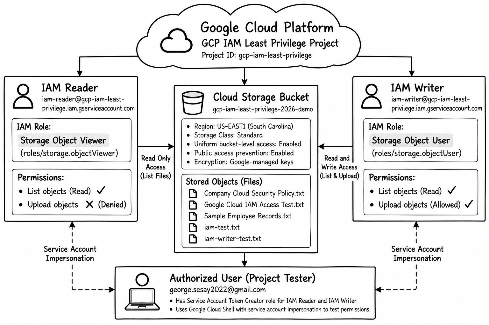
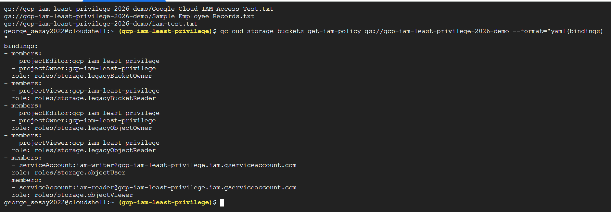
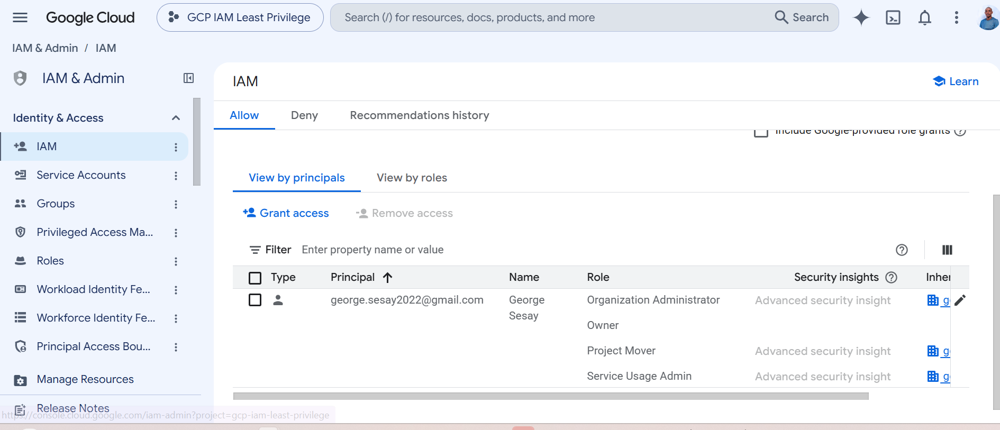
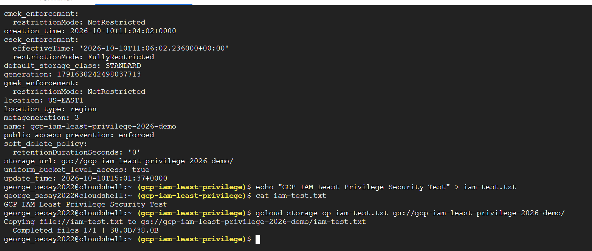
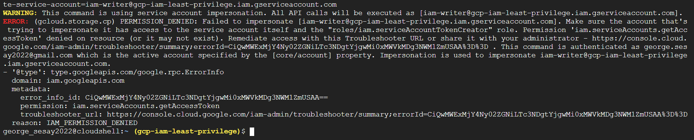
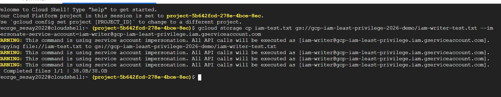
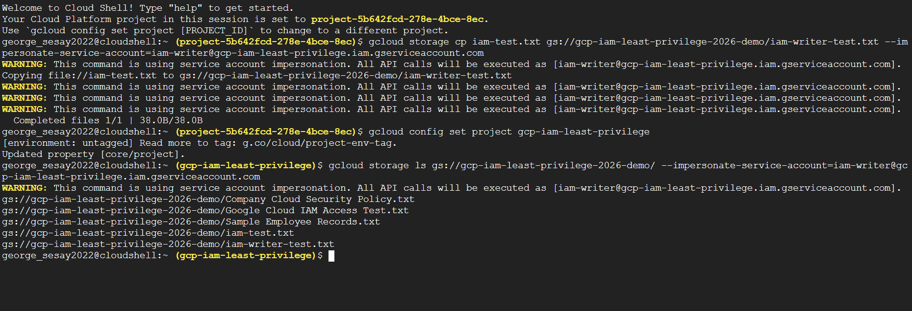
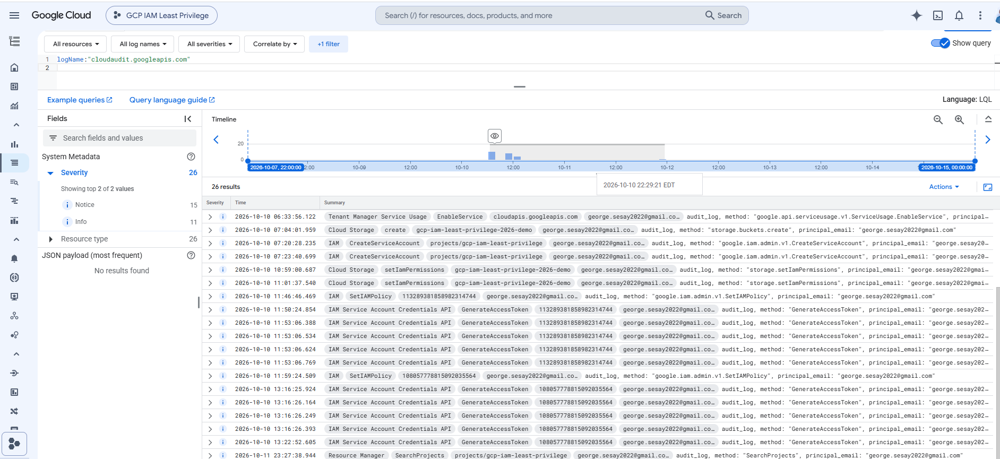

# GCP IAM Least Privilege Security Project

**Google Cloud IAM and Service Accounts Security Project**

## Project Links

- **GitHub Repository:** [View Project Repository](https://github.com/leonetech-2026/gcp-iam-least-privilege-project)
- **GCP Working Environment:** [Google Cloud Project Dashboard](https://console.cloud.google.com/home/dashboard?project=gcp-iam-least-privilege)
- **Architecture Diagram:** [View Security Architecture](https://github.com/leonetech-2026/gcp-iam-least-privilege-project/blob/main/diagram.png)
- **Presentation Slides:** [View Project Presentation](https://docs.google.com/presentation/d/1xm9LhcoWYKnEH3b6ag9PGbShNFfTFLrX/edit?usp=sharing&ouid=102980885387166603628&rtpof=true&sd=true)

**Note:** Google Cloud dashboard. Permissions Required This is not an app that is open to the public. Access to the presentation depends on sharing permissions on Google Drive.

## Project Overview

This project shows how Google Cloud Platform (GCP) Identity and Access Management (IAM) secures cloud resources by the **principle of least privilege**.

This project showcases secure access management using Google Cloud Storage, IAM policies and two service accounts with different permissions.

The IAM Reader service account has read-only access and the IAM Writer service account has permission to read and upload storage objects.

Tests were run in Google Cloud Shell and by using service account impersonation to test successful operation and permission denied behavior.

**Project Status:** IAM configuration, service account permissions, Cloud Storage access testing, Cloud Audit Logs verification have been performed. The evidence is documented with screenshots and outputs of Google Cloud Shell commands. All seven test cases documented passed.

## Project Objectives

- Know about IAM principals, roles, permissions and policies.
- Set up access with pre-defined roles with restricted permissions.
- enforce the principle of least privilege.
- Properly configure service accounts.
- Test allowed reads and writes.
- Check restrictions on unauthorized access.
- Evidence of document configuration and security testing.

## Technologies and Services

| Technology | Purpose |
| --- | --- |
| Google Cloud Platform | Cloud computing environment |
| Cloud IAM | Access control and role assignments |
| Service Accounts | Separate Reader and Writer identities |
| Google Cloud Storage | Storage resource for testing |
| Google Cloud Shell | Command-line configuration and testing |
| Service Account Impersonation | Test permissions without downloading keys |
| Cloud Audit Logs | Review supported administrative and access events |
| GitHub | Version control and project documentation |

## Security Architecture



The diagram shows the interaction between the Google Cloud environment, the IAM Reader, the IAM Writer, and the secure Cloud Storage bucket.

The IAM Reader is read only, IAM Writer can perform authorized read and write operations.

**Security principle:** Users and service accounts are given only the permissions they need to perform their assigned responsibilities.

## Implementation Plan and Completed Activities

### Step 1: Prepare the Google Cloud Project

1. Sign in to Google Cloud Console.
2. Choose the project `gcp-iam-least-privilege`.
3. Check billing and budget settings.
4. Turn on Google Cloud Shell for the project.
5. Locate the Cloud Storage bucket used for testing.

**Project ID:** `gcp-iam-least-privilege`

**Storage Bucket:** `gcp-iam-least-privilege-2026-demo`

**Bucket Region:** `US-EAST1`

### Step 2: Review IAM Access

1. Go to IAM & Admin > IAM.
2. Review the principals and their assigned roles.
3. Determine the storage permissions needed.
4. Check the mappings of IAM Reader and IAM Writer roles.
5. Review the bucket IAM policy in the Google Cloud Shell.
   
### Step 3: Configure Least Privilege

Two service accounts were configured with separate responsibilities.

| Service Account | IAM Role | Access |
| --- | --- | --- |
| IAM Reader | Storage Object Viewer | Read and list storage objects |
| IAM Writer | Storage Object User | Read, list, and upload storage objects |

The roles were assigned to the Cloud Storage bucket.

### Administrative Access and Least Privilege Scope

This project showcases least privilege by using two service accounts with different Cloud Storage permissions. The IAM Reader uses the Storage Object Viewer role and the IAM Writer uses the Storage Object User role.

The IAM policy evidence also has broader administrative permissions for other project principals. These administrative permissions are different than the permissions of the service account tested in this project. The demonstrated least privilege enforcement is limited to the Reader and Writer service accounts accessing the selected Cloud Storage bucket.

The bucket configuration has:

- Bucket-level access uniformly enabled.
- Entry to the public prohibited.- Default storage class.
- Keys that are managed by Google.
  

### Step 4: Review Service Account Security

1. Navigate to IAM & Admin > Service accounts.
2. Check that the Reader and Writer service accounts exist.
3. Verify permissions.
4. Make sure that no service accounts require downloaded private keys to test.
5. Set up authorized service account impersonation.

The first attempt to impersonate failed because the user being tested did not have the necessary Service Account Token Creator permission.

Once the proper impersonation permissions were configured, testing was successful.

### Step 5: Validate Access

Operations were tested in Cloud Shell with the configured service account identities.

The tests revealed that:

- Storage operations permitted successfully.
- The IAM Reader was able to list storage objects.
- New object could not be created by IAM Reader.
- IAM Writer could upload objects
- The IAM Writer can list storage objects.

## Testing Results

| Test Case | Expected Result | Actual Result |
| --- | --- | --- |
| Authorized storage upload | Upload succeeds | Passed |
| IAM Reader lists objects | Read permitted | Passed |
| IAM Reader uploads object | Permission denied | Passed |
| IAM Writer uploads object | Upload succeeds | Passed |
| IAM Writer lists objects | Read permitted | Passed |
| IAM role verification | Assigned roles visible | Passed |
| Cloud Audit Logs review | Relevant events visible if enabled | Passed |

## Evidence and Screenshots

The following screenshots document the IAM configuration and testing activities.

### Evidence 1: IAM Role Assignments

This screenshot shows the IAM configuration used to manage access to the Google Cloud environment.



### Evidence 2: Service Account Configuration

This screenshot shows the IAM Reader and IAM Writer service accounts configured for the project.



### Evidence 3: Successful Storage Upload

A test file was successfully uploaded to the Cloud Storage bucket using an authorized identity.



### Evidence 4: Permission Denied

The IAM Reader tried to upload a file but was unable to do so as it didn't have the `storage.objects.create` permission.

This is showing least privilege enforcement .



### Evidence 5: Authorized Writer Access

The IAM Writer successfully uploaded a test file to the Cloud Storage bucket using service account impersonation.



### Evidence 6: Writer Read Access

The IAM Writer successfully listed objects stored in the Cloud Storage bucket.



### Evidence 7: Cloud Audit Logs Verification

We looked at security-related activity in the Google Cloud’s Logs Explorer. The review identified 26 audit log entries, including IAM policy changes, Cloud Storage permission changes, and service account access token generation events.

The SetIAMPolicy audit record verifies that Google Cloud has logged an IAM policy operation.

**Result:** Passed. Relevant administrative audit logs were successfully retrieved.



## Repository Structure

```text
gcp-iam-least-privilege-project/
├── README.md
├── diagram.png
└── screenshots/
    ├── README.md
    ├── iam-role-assignments.png
    ├── service-account-configuration.png
    ├── storage-upload-success.png
    ├── authorized-access.png
    ├── permission-denied.png
    ├── writer-read-access.png
    └── cloud-audit-logs.png
```


## Expected Results and Achievements

- IAM role assignments documented.
- Create separate reader and writer service accounts.
- Allowed Cloud Storage actions (certified).
- Permisssion denied behavior demonstrated.
• Confirmed least privilege enforcement.
- Documented security architecture.
- Evidence of cloud security testing collected.

## Security Best Practices

- Only grant the permissions necessary for the tasks assigned.
- Different roles should have different identities.
- Do not give Owner and Editor permissions unnecessarily.
- Prefer service account impersonation to downloadable keys.
- Allow for the avoidance of public access where appropriate.
- Regularly review IAM policies.
- Use Cloud Audit Logs for support security investigations.
- NEVER post private keys, access tokens, credentials, etc.
- Clean up temporary lab resources after assignment is completed.

### Scope of the Project
This project shows how to restrict IAM access to a chosen Cloud Storage bucket. It’s not a full production security deployment.

You need to be authenticated and have the correct IAM permissions to access the Google Cloud Console dashboard.

Verifying Cloud Audit Logs Using Google Cloud Logs Explorer. We retrieved a total of 26 relevant audit log entries including IAM policy operations, Cloud Storage permission updates, and service account access token creations. Availability of audit logs depends on the Google Cloud service and logging configuration.

## Final thoughts

This project successfully demonstrates how Google Cloud IAM and service accounts support the principle of least privilege.

The IAM Reader could perform authorized read operations, but it could not upload objects. The IAM Writer was able to perform authorized storage operations

The results show the importance of properly configured IAM permissions to protect cloud resources against unauthorized access.

You also get hands-on experience with cloud security configuration, service account management, permission testing, and technical documentation writing.


## References

- [Google Cloud IAM Overview](https://cloud.google.com/iam/docs/overview)
- [IAM Roles and Permissions](https://cloud.google.com/iam/docs/understanding-roles)
- [Service Accounts Overview](https://cloud.google.com/iam/docs/service-account-overview)
- [Cloud Storage IAM Roles](https://cloud.google.com/storage/docs/access-control/iam-roles)
- [Service Account Impersonation](https://cloud.google.com/iam/docs/impersonating-service-accounts)
- [Cloud Audit Logs Overview](https://cloud.google.com/logging/docs/audit)
